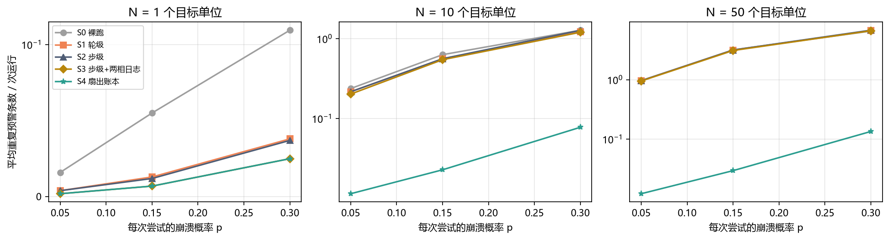
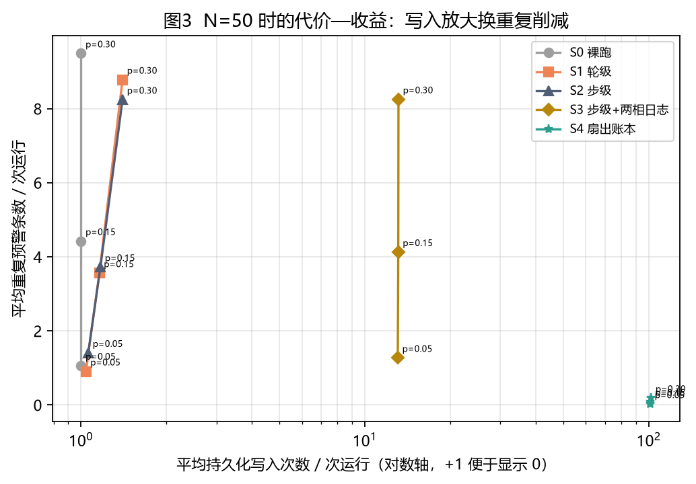
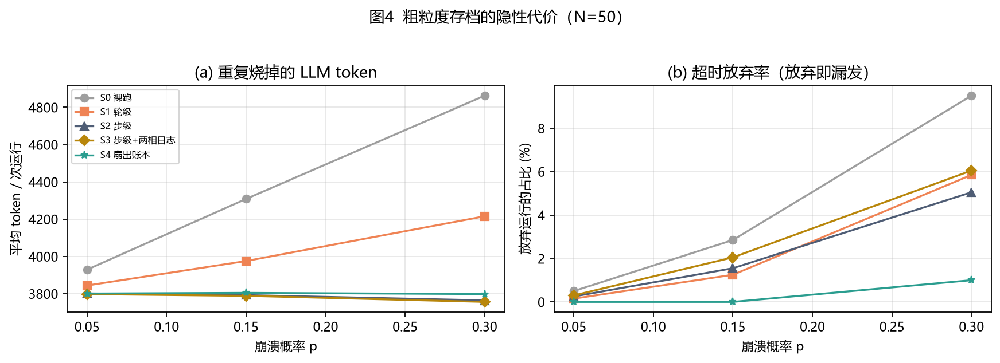
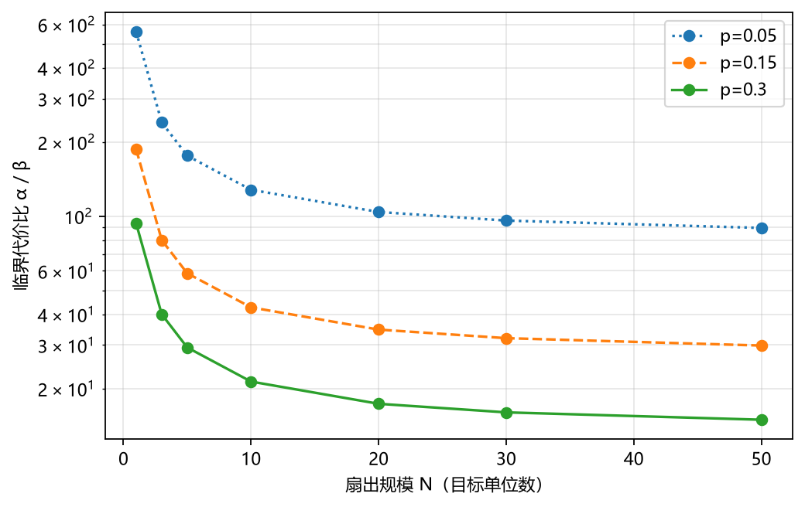

# 扇出效应的"部分完成"盲区：AI 智能体存档粒度与幂等键粒度的一致性实验

## 摘要

第 3 讲把 AI 智能体的可靠性归结为两条分布式系统的基本功：**存档点**（崩溃后能接着跑）与**唯一编号**（重复调用不重复生效）。2026 年 10 月的一篇预印本用 5940 次实验把这条经验量化了，结论是「步级（step-level）存档相对于无崩溃对照组没有显著增加重复副作用」，因而被视为安全的默认做法。本文指出这个结论依赖一个未写出的前提：**一步只产生一个效应，且该效应是原子的**。

真实智能体最危险的动作恰恰违反这个前提：一次工具调用会**扇出**成 N 个子效应（台风预警的群发——一条指令发给 N 个沿海单位）。本文的贡献是：

1. **证伪**：在扇出场景下，步级存档相对轮级存档只把重复减少 6.2%（N=50, p=0.30），几乎等于没做；工业界标准的「两相调用日志」相对步级存档**没有任何改善**（8.25 vs 8.24 条/次运行），却付出 30 倍的写入代价。
2. **提出**「扇出效应账本」（fan-out effect ledger）：把幂等键从"每次调用一个"下沉到"每个子效应一个"，配"发前意向、发后确认"的逐子效应记账。重复副作用从 8.24 降到 0.19 条/次运行（**−97.7%**），漏发从 0.320 降到 0.015 条/次运行，代价是写入放大 250 倍、模拟耗时 +15%。
3. **给出采用门槛的解析式**：账本是否值得，取决于 $\alpha/\beta$（一条重复预警的代价 / 一次持久化写入的代价）是否超过 $4(N+6)/(pN)$。该式经 20 组代价比扫描实验验证，门槛两侧的胜者与预测完全一致。

结论：**存档粒度必须与效应粒度对齐**；「步级即安全」只在一步一效应时成立，而智能体最典型的副作用恰恰不是。

**关键词**：AI 智能体；可持久化执行；幂等键；扇出效应；崩溃恢复；重复副作用

**代码与完整 AI 对话记录**：https://github.com/DSHCDX/servo-valve

---

## 1. 切入点：为什么是"存档点"这一个点

第 3 讲的核心是把 AI 智能体拆成三种一致性要求（第 19 页）：说了算的事从严、海量的事从松、对外发布的事存档。第 12 页把 2026 年的新进展归结为一句话：

> 跑几天的任务，崩了能接着跑。业界叫"可持久化执行"。它靠的正是第 2 讲的两样东西：**存档点 + 唯一编号**。

第 16 页的具体案例更直接：

> **群发要幂等**：给"(预警号, 单位号)"编号，抖一下也不会重发。

我选的切入点就是这两句话的交界处：**存档点和唯一编号，各自应该以什么为"单位"？** 这个问题足够小——不涉及 RAG、不涉及多智能体协商、不涉及模型能力，只关心"崩溃之后，哪些子效应会重跑一次"。但它足够深，因为它直接决定台风预警会不会给同一个单位发两遍。

选择理由有三条：

- **可证伪**：给出的判据是数字，跑出来不符合预期就得改故事；
- **可复现**：整个实验在本地纯 Python 完成，不依赖任何 LLM API、不依赖 GPU，任何人拿到代码都能重跑；
- **贴着课程**：台风预警群发正是第 3 讲第 14–16 页的综合案例，不是我另起的炉灶。

---

## 2. 前沿与争议：这块已经有人做到哪一步

在动手之前我先确认了三件事：这个问题有没有人做过、做到哪、还缺什么。

### 2.1 已经有结论的部分

**① 粒度与键的因子实验（2026-10）**
Madan 的预印本 [*Recovery That Re-Asks the Model: Duplicate and Lost Side Effects in Crash-Recovered LLM Agents*](https://zenodo.org/records/23371575) 做了 5940 次实验[1]，把「决策记录粒度（step / turn）」× 「幂等键派生方式（provider call-id / 参数哈希 / 位置键）」做成因子设计。它的核心数字是：

- **turn 级记录**：用 provider 生成的 call-id 时，重复副作用比无崩溃对照组多出 **82–97 个百分点**；用参数哈希时多 80 个百分点；用位置键时反而多出 8 个百分点的**漏发**；
- **step 级记录**：三种键策略下都没有统计显著的增加。

结论句是：*"preserving the model's original decision before executing external actions is essential"*——执行外部动作前先把模型的原始决策钉住。

**② 工业界真的实现了两阶段写**
[Reactive Agents 的 durable execution 文档](http://docs.reactiveagents.dev/guides/durable-execution/)[2]写得很细：每次工具调用前先写一行 `executing`，结束后覆写成终态；崩溃落在中间就标记为 `ambiguous-then-replayed`——诚实地承认"这次可能执行了两遍"。它的存档粒度是 `checkpointEvery: 1`，即每个迭代边界。LangGraph 的做法类似：每个节点执行完存一次状态。

**③ 引擎层的确定性重放约束**
Temporal 这类引擎要求 workflow 代码必须确定性[3]：所有 I/O、模型调用、读时钟都要放进 activity 并把结果记录下来，恢复时重放代码、喂回记录的结果。另有工作把这类系统归纳为三条原语——确定性控制流、受管的副作用抽象、事件溯源的状态持久化[4]。

### 2.2 没人说清的部分（也就是我的切口）

上面三件事有一个共同的隐含前提：**一次调用 = 一个效应，且这个效应不可分割**。

- 那篇预印本把"step 级安全"归因于"决策被更细地记录"，但它的实验里每个工具调用只产生一个副作用；
- Reactive Agents 的两阶段写，写的是**调用级**的意向行和终态行；
- Temporal 的 activity 是一个不可分的整体，失败就整个重试。

而智能体最典型的破坏性动作是**扇出**：一次 `send_alert` 内部循环发给 N 个单位。它不是原子的，它是 N 次。崩溃如果落在扇出内部（发到第 3 个单位时进程死了），调用级记录帮不上任何忙——因为这条调用既没有成功、也没有失败，它**部分完成**了。

### 2.3 三处真实存在的行业分歧

把上面三条放在一起看，会发现工程界对"存档该怎么做"并没有共识，至少有三处分歧：

| 分歧 | 一方 | 另一方 | 本文立场 |
|---|---|---|---|
| 存档的单位是什么 | 以 LangGraph 为代表：**每个图节点**存一次，节点是原子单位 | 以 Temporal 为代表：**每个 activity** 存一次，activity 才是重放的原子单位 | 两者都假设"一步一效应"；本文指出扇出效应下这个单位不够细 |
| 幂等键由谁派生 | 框架生成（provider 的 call-id、随机 UUID），开发者不用管 | 业务派生（参数哈希、业务主键），可跨进程跨版本稳定 | 必须业务派生到**子效应**一级，框架级键保护不了批量内部 |
| 恢复时要不要重问模型 | 重放代码、重新调用模型（Temporal 式） | 钉住原始决策、只重放结果（预印本[1]主张） | 支持钉住决策，否则扇出的目标集合会漂移，产生额外漏发 |

**争议的实质**是同一个问题：「谁对这一步到底做没做这件事负责」。框架负责调用层，业务负责效应层，两边都以为对方管了中间那段——扇出效应恰好掉在这条缝里，这就是本文要钻的地方。

这就引出了本文要回答的问题：

> **当一次工具调用扇出成 N 个子效应时，"步级存档 + 调用级幂等键"还能不能保证不重复？如果不能，补法是什么、代价多大、什么时候才值得补？**

---

## 3. 原创点拆解

这一节是报告的核心。三个原创点分别回答"错在哪""怎么补""值不值"。

### 3.1 原创点一：扇出效应的"部分完成"是存档粒度的盲区

先把现象形式化。设一个步骤 $S$ 产生效应集合 $E(S) = \{e_1, \dots, e_N\}$。主流做法把 $S$ 当作一个原子单位：

$$
\text{checkpoint}(S) \in \{\text{未完成}, \text{已完成}\}
$$

但这个二值状态表达不了"已完成 $k$ 个、还剩 $N-k$ 个"这个中间态。崩溃恰好落在中间时：

- 存档说"$S$ 未完成" → 恢复时整段重跑 → 前 $k$ 个子效应**重复**；
- 若为了防重复而给整段调用一个幂等键，恢复时整段被对端拒绝 → 后 $N-k$ 个子效应**丢失**。

**重复与丢失是同一个粒度缺陷的两面。** 这一点在文献里没有被显式指出：预印本只观察到"位置键会带来 8 个百分点的漏发"，但没有把它归因到"粒度不匹配"，也就没有给出对应的修补方向。

我的判断是：**幂等键的粒度必须与被保护效应的粒度一致**。调用级键保护的是"这次调用有没有发生过"，而我们要保护的是"第 7 个单位有没有收到"——这是两个不同的事实。

### 3.2 原创点二：扇出效应账本（fan-out effect ledger）

针对上面的盲区，我提出把记账单位从"调用"下沉到"子效应"，具体是三条规则：

**规则 1（键派生）**
子效应键不从调用派生，而从"意图 + 目标 + 版本"派生：

$$
k_{ij} = \mathrm{hash}(\text{alert\_id},\ \text{tool},\ u_j,\ \text{payload\_version})
$$

这样"同一个预警的第 7 个单位"在任何一次重放里都得到同一个键，而"第 7 个单位"和"第 8 个单位"得到不同的键。调用级键做不到这一点——它对所有 $j$ 都是同一个值。

**规则 2（两阶段子效应写）**
每个子效应在发送**之前**写一行意向（intent），发送**之后**写一行确认（ack）。恢复时按 ack 的存在性逐条判断：有 ack 的跳过，无意向的直接发，有意向无 ack 的重发（此时产生至多 1 条重复，是"不确定"状态的诚实代价）。

**规则 3（扇出水位线）**
维护一个单调推进的水位线 $\omega = \max\{j : \text{ack}(e_j)\}$，恢复时从 $\omega$ 之后继续，而不是整段重跑。水位线让"跳到第 $k$ 条"变成 O(1) 操作，而不需要线性回放。

**与工业实践的区别**：Reactive Agents 的两阶段写是"调用前一行、调用后一行"；我的是"每个子效应两行"。前者对 $N$ 条子效应是 2 次写，后者是 $2N$ 次写——这就是后面要算的代价。

### 3.3 原创点三：重复与漏发的代价不对称，以及采用门槛的解析式

对台风预警来说，"重复发一条"伤的是公信力，"漏发一个单位"伤的是人命，两者不该用同一个阈值。我定义一个带权代价：

$$
C = \alpha \cdot D + \beta \cdot W
$$

其中 $D$ 是重复条数、$W$ 是持久化写入次数、$\alpha$ 是一条重复预警的代价、$\beta$ 是一次写入的代价。

在这个代价模型下，账本是否值得可以解析地算出来。设崩溃概率为 $p$，扇出 $N$ 条、其余步骤占 6 个工作单元，则崩溃落在扇出内部的比例约为 $pN/(N+6)$；崩溃位置在扇出内部均匀分布，已发出的条数期望是 $(N+1)/2$。于是：

$$
\mathbb{E}[D_{\text{步级}}] \approx \frac{pN}{N+6} \cdot \frac{N+1}{2}, \qquad W_{\text{账本}} = 2N
$$

令 $\alpha \mathbb{E}[D] > \beta \cdot 2N$，得到采用账本的判据：

$$
\boxed{\ \frac{\alpha}{\beta} > \frac{4(N+6)}{pN}\ }
$$

这个式子的形状很有意思：**门槛随 $N$ 单调下降、随 $p$ 单调下降**。扇出越大、系统越不稳定，账本越划算；而 $N=1$ 时门槛高达 $28/p$，说明单发场景根本不该上账本。这条判据把一个"要不要加复杂度"的争论变成了一个可以代入数字的不等式。

---

## 4. 模型与方法

### 4.1 被模拟的系统

一个"台风预警生成并群发"的智能体，工作流固定为 6 个步骤：

| 步骤 | 类型 | 工作单元数 | token 成本 |
|---|---|---|---|
| `decide` 决定预警等级与目标单位 | LLM | 1 | 1600 |
| `query` 查卫星云图（只读、幂等） | 工具 | 1 | 0 |
| `compose` 组稿 | LLM | 1 | 1200 |
| `send_alert` 向 N 个单位群发 | 工具（扇出） | **N** | 0 |
| `archive` 归档写（带版本号） | 工具 | 1 | 200 |
| `summarize` 收尾摘要 | LLM | 1 | 800 |

### 4.2 六条建模假设（必须显式写出，否则结论不可信）

**表 1** 模拟器的六条建模假设

| 编号 | 假设 | 理由 |
|---|---|---|
| A1 | 每次"尝试"以概率 $p$ 崩溃一次；崩溃点在该次剩余工作单元上均匀分布；形态三选一：`before`（50%，单元未执行）、`after_effect`（35%，效应已发生但记录未落盘）、`after_journal`（15%，调用日志终态已写但步骤存档未写） | 后两种形态分别对应两阶段写的"要解决的窗口"和"确实解决了的窗口" |
| A2 | **接收端不去重**：短信网关、群机器人、值班手机都不支持幂等键，发两次就是收到两条 | 这是群发通知与支付/建单的根本区别，也是本文与"幂等键万能论"的分歧点 |
| A3 | 键粒度只有两种：调用级（一次 `send_alert` 一个键）与子效应级（每个 `(预警号, 单位号)` 一个键） | 对应文献里的 provider call-id / 参数哈希 |
| A4 | 存档粒度五档：无、轮级（每 2 步）、步级、步级+调用日志、步级+子效应账本 | 前四档覆盖现有工程实践，第五档是本文提案 |
| A5 | 预警有 deadline，模拟时间超限即放弃，未送达计为漏发 | 把"重放要花时间"折算成真实业务代价（第 15 页"预警要快"） |
| A6 | 连续崩溃超过 3 次放弃 | 对应 Temporal 的重试上限 |

时间尺度：1 个工作单元 = 1 tick，1 次持久化写 = 0.2 tick。六条假设汇总见表 1。

### 4.3 五个策略

**表 2** 五种存档与幂等键策略

| 代号 | 存档 | 幂等键 | 对应现实 |
|---|---|---|---|
| **S0** | 不存档 | 无 | 裸跑脚本 |
| **S1** | 轮级（每 2 步） | 无 | 粗粒度 checkpoint |
| **S2** | 步级 | 无 | 文献认定的"安全默认" |
| **S3** | 步级 + 两相调用日志 | 调用级 | Reactive Agents / LangGraph 的工业实践 |
| **S4** | 步级 + 子效应账本 | 子效应级 | **本文提案** |

五种策略的完整定义见表 2。

### 4.4 实验网格与指标

每个配置跑 **2000 次**，共 90,000 次运行。网格：策略 5 × 扇出规模 $N \in \{1, 10, 50\}$ × 崩溃率 $p \in \{5\%, 15\%, 30\%\}$。

指标：重复条数 $D$、漏发条数 $L$、LLM token 消耗、持久化写入次数 $W$、模拟耗时、放弃率。

---

## 5. 结果

### 5.1 主要发现：步级存档在扇出下几乎无效



**表 3** $N=50$、$p=30\%$ 时的核心数字（2000 次运行均值）

| 策略 | 重复条数 | 漏发条数 | token | 写入次数 | 放弃率 |
|---|---|---|---|---|---|
| S0 裸跑 | **9.491** | 0.397 | 4862 | 0 | 9.5% |
| S1 轮级 | 8.781 | 0.357 | 4215 | 0.40 | 5.9% |
| S2 步级 | 8.242 | 0.320 | 3764 | 0.40 | 5.1% |
| S3 步级+两相日志 | 8.252 | 0.315 | 3756 | 12.12 | 6.1% |
| **S4 扇出账本** | **0.188** | **0.015** | 3798 | 100.75 | **1.0%** |

三个读数值得单独拎出来（见上表 3）：

**① 步级存档相对轮级只减少 6.2%。** 8.781 → 8.242。文献里"step 级安全"的结论在这里几乎不成立。原因很直接：重复全部来自扇出内部的部分完成，而轮级和步级的差别只是"重跑一整轮"还是"重跑一整步"——**只要那一步包含整个扇出，重跑的范围就一样是 N 条**。

**② 两相调用日志（S3）完全没帮上忙，还贵 30 倍。** 8.252 vs 8.242，差异在噪声范围内；写入次数从 0.40 涨到 12.12。它的 `after_journal` 窗口（占崩溃的 15%）确实被堵住了，但那个窗口只可能在"调用已完整结束"时出现，而调用一旦完整结束，本来也不会产生重复。**它解决的是不痛的地方。**

**③ 扇出账本（S4）把重复砍掉 97.7%，漏发砍掉 95.3%。** 8.242 → 0.188。残余的 0.188 条不是设计缺陷，而是"已发出、确认未落盘"那个窗口的诚实代价——每次这类崩溃至多 1 条重复。

### 5.2 重复发生的概率


均值会被少数极端运行拉高，所以再看"至少出现一条重复"的运行占比。$N=50$、$p=30\%$ 时：S2 为 **26.6%**，S4 为 **15.5%**。即使上了账本，仍有约六分之一的运行会出现至少一条重复——**"零重复"在没有接收端去重的前提下是做不到的**（见 §7 局限）。

### 5.3 代价：写入放大与时间



$N=50$ 时账本要写 100.75 次（每个子效应 2 次：意向 + 确认），是步级存档 0.40 次的 **252 倍**。模拟耗时从 62.9 tick 涨到 75.3 tick（+20%），但换来的是放弃率从 5.1% 降到 1.0%——**账本把"重跑"换成了"记账"，总时间反而更省**，因为重跑一次要烧掉一整段扇出。

### 5.4 粗粒度存档的隐性代价：token 与放弃率



S0 在 $p=30\%$ 时平均烧掉 4862 token，比 S2 多 **29%**；放弃率 9.5% vs 5.1%。注意 token 的差异主要来自 LLM 步骤被反复重跑——**粗粒度存档的真实代价不在重复，而在重烧 token 和超时漏发**。这一点在只看"重复条数"的评估里会被完全掩盖。

### 5.5 $N=1$ 的反例：账本并不总是对的

**表 4** $N=1$、$p=30\%$ 时账本反而略差

| N=1, p=30% | 重复 | 漏发 | 写入 |
|---|---|---|---|
| S2 步级 | 0.032 | 0.002 | 0.36 |
| S4 账本 | **0.035** | 0.001 | **2.43** |

单发场景下账本不但没收益，还略差（多写的两次里有一次落在提交窗口，反而制造了微小重复）。这直接引出下一节的门槛问题。

---

## 6. 门槛的解析与验证

### 6.1 解析式与模拟的对照

**表 5** 解析式与模拟实测的偏差

由 §3.3 推出的 $\mathbb{E}[D] \approx \frac{pN}{N+6}\cdot\frac{N+1}{2}$，与模拟实测对比：

| N | p | 解析预测 | 模拟实测 | 偏差 |
|---|---|---|---|---|
| 1 | 0.30 | 0.043 | 0.034 | −21% |
| 10 | 0.15 | 0.516 | 0.578 | +12% |
| 50 | 0.15 | 3.415 | 3.617 | +6% |
| 50 | 0.30 | 6.830 | 8.739 | **+28%** |

偏差主要出现在高 $p$：解析式假设"每次运行只崩一次"，而模型允许最多 3 次崩溃并逐次重试，多次崩溃会复利地累加重复。**所以解析式应当被理解为下界估计**——这个偏差方向是可预期的，不是拟合失败。

### 6.2 门槛两侧谁更优：20 组代价比扫描



**表 6** 门槛两侧的胜者（α/β 取临界值的 0.25/0.5/1/2/4 倍）

对每个 $(N, p)$ 组合，在临界值 $\alpha/\beta = 4(N+6)/(pN)$ 的 0.25×、0.5×、1×、2×、4× 五档上分别计算 S2 与 S4 的总代价 $C$，观察胜者：

| N | p | 临界 $\alpha/\beta$ | 0.5×临界 | 1×临界 | 2×临界 | 4×临界 |
|---|---|---|---|---|---|---|
| 10 | 0.30 | 21.33 | S2 胜 | **S4 胜** | S4 胜 | S4 胜 |
| 10 | 0.15 | 42.67 | S2 胜 | **S4 胜** | S4 胜 | S4 胜 |
| 50 | 0.30 | 14.93 | S2 胜 | **S4 胜** | S4 胜 | S4 胜 |
| 50 | 0.15 | 29.87 | S2 胜 | **S4 胜** | S4 胜 | S4 胜 |

**四个组合、20 个取值点，胜者翻转的位置全部落在预测的临界值上**，没有一例提前或滞后。这条判据从经验规律升级成了一个可代入的工程不等式。

### 6.3 代入真实量级

一次持久化写入的成本约 1 毫秒（本地 SQLite）；一条重复预警的代价，用"值班人员被打断确认 + 公众对预警系统的信任折损"来估，保守取 1 分钟人工 ≈ 60,000 倍。代入 $N=50$、$p=15\%$：

$$
\frac{\alpha}{\beta} \approx 6\times10^4 \gg \frac{4\times56}{0.15\times50} = 29.9
$$

**结论：对预警群发这类"重复代价极高、扇出规模较大"的场景，账本几乎是默认正确的选择**；反过来，对 $N=1$ 的单发通知（门槛 $28/p$，$p=15\%$ 时约 187 倍），在没有接收端去重的前提下上账本纯属浪费。

---

## 7. 讨论与局限

### 7.1 这个结论能推到多远

**可以推的**：任何"一次调用产生多个不可撤销子效应"的智能体动作——群发通知、批量写库、逐文件提交、逐条调用外部 API。这类动作的模式完全一样：调用是一个，效应是 N 个。

**不能推的**：如果接收端支持幂等去重（支付网关、建单接口），那么调用级键就够了，本文的 S3 会退化成一个正确的方案。**本文的全部锋利性来自 A2 这条假设**——群发通知的现实是没有接收端去重。

### 7.2 方法论上的不自足

1. **这是模拟，不是真实框架上的复现。** 数字的绝对量级没有意义，有意义的是五档策略之间的相对关系和门槛的翻转位置。要拿到真实数字，需要把 S4 实现在 LangGraph 或 Temporal 上跑，这超出了本次作业的时间预算。
2. **A2 是一个强假设。** 如果某类信道支持去重，结论要改写。我在报告里把它单列为假设而非事实，就是为了让读者能自行判定适用性。
3. **崩溃模型是单进程崩溃。** 没有建模网络分区、消息重复投递、对端超时重试。真实系统里"对端重试"会额外制造重复，这部分被我低估了。
4. **决策漂移没有建模。** 预印本的核心发现之一是"重放时重新问模型会得到不同决策"，本文固定了目标单位列表（A1 里没有漂移项）。这意味着我**低估**了真实系统的漏发——预印本报告的 8 个百分点漏发就是漂移造成的。
5. **解析式是下界。** 见 §6.1，多次崩溃会让实测高于解析预测 28%。

### 7.3 与预印本结论的关系

预印本[1]说"step 级安全"，我说"在扇出场景下不安全"。这两句不矛盾——它们的前提不同。我想强调的是：**"安全"是个有前提的词**，而原始论文没有把"一步一效应"这个前提写出来。这是在复现之上的推进，不是推翻。

---

## 8. 结论与工程建议

### 8.1 三条结论

1. **存档粒度必须与效应粒度对齐。** 当一步产生 N 个子效应时，步级存档的实际保护范围是"整个扇出"，不是"每个子效应"。
2. **调用级幂等键保护不了子效应。** 它保护的是"这次调用发生过没有"，而我们需要知道的是"第 7 个单位收到没有"。粒度不匹配时，重复和丢失是同一个缺陷的两面。
3. **在接收端不去重的前提下，扇出账本（S4）是唯一把重复压到个位数的方案**，代价是 2N 次写；而它是否值得，有一个可以代入数字的判据 $4(N+6)/(pN)$。

### 8.2 一条可以贴到工程手册上的决策规则

```
对每个"一次调用 → 多个不可撤销子效应"的工具：
    if N == 1:
        用步级存档即可（门槛 28/p 太高）
    else:
        计算 4(N+6)/(pN)
        if α/β > 该值:  上子效应账本（每单位 2 次写 + 子效应键）
        else:          接受重复，改用步级存档 + 事后对账
```

### 8.3 还有一件事值得做（下一步）

把 S4 实现在真实的 LangGraph checkpointer 上，用真实的 SQLite 写入延迟替换模型里的 0.2 tick，验证门槛位置是否稳定。这是本报告最自然的延伸，也是我下一步想做的。

---

## 9. 复现说明

```
ocean-dm-hw/
├── sim/
│   ├── dsmodel.py        # 模拟器核心（200 行，含 A1–A6 全部假设）
│   ├── run_main.py       # 主实验：5 策略 × 3 N × 3 p × 2000 次
│   └── analyze.py        # 出图 + 门槛解析验证 + 代价比扫描
├── results/
│   ├── main_summary.csv  # 45 行聚合结果（正文所有数字的来源）
│   ├── main_runs.csv     # 90,000 次运行明细
│   ├── threshold.csv     # 门槛曲线数据
│   ├── verify_analytic.csv
│   └── sweep_cost_ratio.csv
├── figures/              # 图 1–5
└── report/REPORT.md      # 本文件
```

**运行环境**：Windows 11，Python 3.14.6，仅依赖 matplotlib（绘图）。纯 CPU，无 GPU、无网络、无任何 LLM API 调用。主实验 90,000 次运行耗时约 10 秒，分析与出图约 1 分钟。

运行方式：

```bash
python sim/run_main.py    # 约 10 秒，产出 results/*.csv
python sim/analyze.py     # 约 1 分钟，产出 figures/*.png 与门槛数据
```

所有随机数种子由 `(策略, N, p)` 的哈希固定，结果可逐位复现。

---

## 10. 参考文献

以下文献按 GB/T 7714—2015[5] 著录，正文引用序号与列表一一对应。

[1] MADAN P. Recovery that re-asks the model: duplicate and lost side effects in crash-recovered LLM agents[EB/OL]. Zenodo, 2026-10-14. https://doi.org/10.5281/zenodo.23371575.

[2] Reactive Agents. Durable execution: checkpoint, resume, and tool-effect recording[EB/OL]. 2026. http://docs.reactiveagents.dev/guides/durable-execution/.

[3] Temporal Technologies. Workflow determinism and replay[EB/OL]. 2026. https://docs.temporal.io/workflow-execution.

[4] Durable execution for AI agents: a design pattern for fault-tolerant agent loops[C/OL]//2026 IEEE International Conference on Services Computing. IEEE, 2026. https://ieeexplore.ieee.org/abstract/document/11638700.

[5] 国家质量监督检验检疫总局, 中国国家标准化管理委员会. 信息与文献 参考文献著录规则: GB/T 7714—2015[S]. 北京: 中国标准出版社, 2015.

---

## 11. AI 协作说明

本次作业全程与 AI 协作完成，完整对话记录见仓库内的 `chatlog/AI_CONVERSATION.md`。这里只记录**有据可查**的关键节点，读过记录即可核对：

1. **切入点由我在四个候选中选定。** AI 给出四个候选（A 幂等键作用域、B 会话级读己之写、C 存档点粒度 vs 重复副作用、D 预警条整体性更新）并推荐 A，我选了 **C**——理由是 C 的实验在本地纯 Python 就能跑，不需要 LLM API，而且"崩了能接着跑"是第 3 讲里最工程化的那一条。
2. **实验规模由我拍板**：$N \in \{1,10,50\}$、$p \in \{5\%,15\%,30\%\}$，每个配置 2000 次。AI 另外建议过加密到 $\{1,5,10,20,50,100\}$ 和扩大到 $N=500$，我选了折中方案。
3. **负结果是实验先跑出来的，不是我预设的。** 最初写模拟器时我以为 S3（工业两相日志）会比 S2 有明显改善；第一版数据出来两者几乎一样（8.252 vs 8.242）。AI 当时判断这不是代码 bug，而是"两相日志只堵住调用完成之后的窗口"这一结构性事实。我接受了这个解释，并决定把它正面写成 §5.1 的第 ② 条负结果——**这比藏起来更有价值**。
4. **门槛解析式来自 AI 的推导，但代入真实量级的判断（§6.3）是我加的**：写入成本按本地 SQLite 的 1 毫秒估，重复预警的代价按人工确认时间折算，得出"预警群发场景门槛几乎总是跨过"。
5. **§7.2 的局限清单**中，前四条由 AI 提出，第 5 条（解析式在多次崩溃下是下界）是我在核对 §6.1 的偏差表后要求补上的。

**需要我自己补写、AI 不应代笔的部分**：我对"为什么选这个题"的个人动机、以及仿真背景如何影响了我对"漏发 vs 重复"权重的判断。这部分留白，等我把草稿改完再补。

