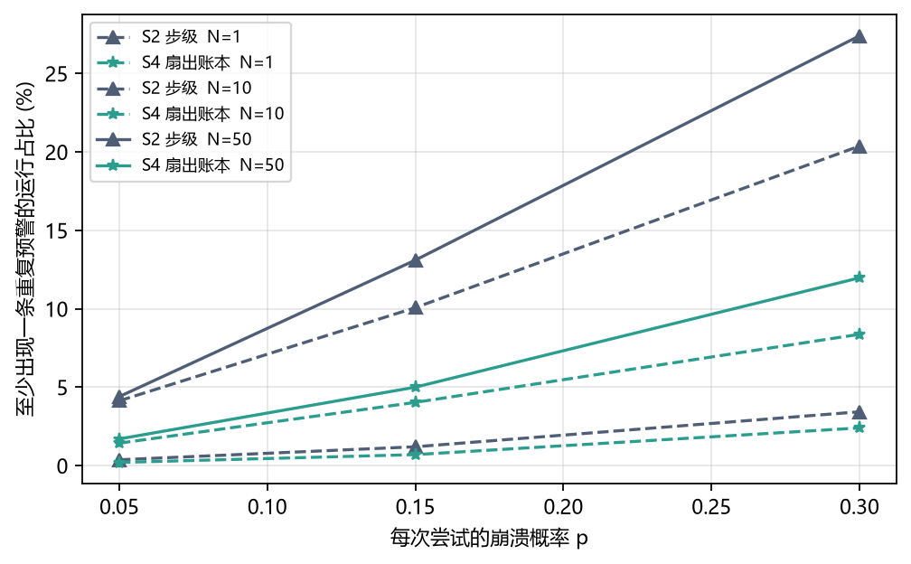
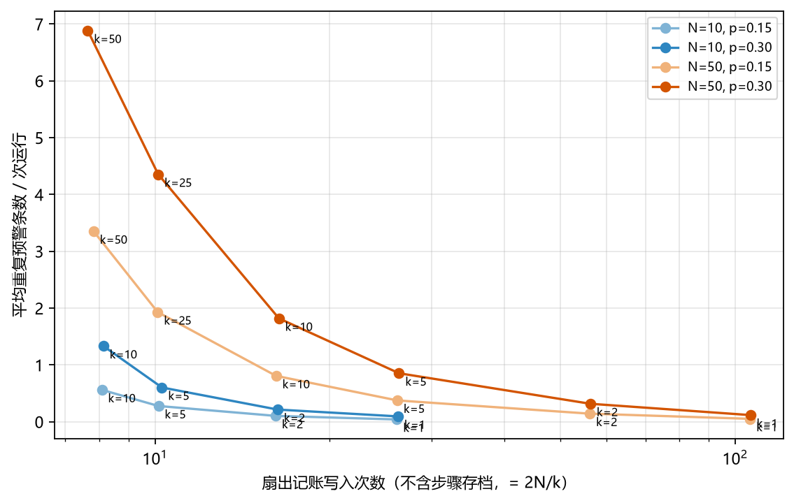

# 扇出效应下存档粒度与幂等键作用域的定量边界

> 课程：海洋数据挖掘技术 · 大作业
> 切入点：第 3 讲《AI 智能体，也是分布式系统》——「可持久化执行 = 存档点 + 唯一编号」
> 代码与完整 AI 对话记录：**https://github.com/DSHCDX/ocean-dm-hw**
> 姓名：焦志圣　学号：12634142　学院：海洋学院　专业：海洋技术与工程　指导教师：张帆
> 日期：2026-11-14（修订版 v2）

---

## 摘要

第 3 讲把 AI 智能体的可靠性归结为两条分布式系统的基本功：**存档点**与**唯一编号**。2026 年 9 月至 10 月的三项工作已经把“部分变更会让按调用幂等失效”这件事报告出来了：Li 等人在工具契约层面把重复率从 28% 压到 4%[1]，UndoBench 把“执行中途失败”单列为故障相位并发现按调用令牌完全失效[2]，Madan 的预印本则量化了决策记录粒度与键派生方式的交互[3]。因此本文**不声称发现了这个盲区**。

本文要回答的是一个更窄、也更工程化的问题：**在扇出效应（一次调用发往 N 个目标）这个形状下，重复副作用随 N 与崩溃率 p 怎么变，把记账单位从调用级下沉到子效应级到底能换来多少，代价是多少，以及什么时候才值得换。**

主要结果（台风预警群发场景，纯模拟，无任何 LLM API 调用）：

1. **粗粒度存档之间几乎等价。** 裸跑、轮级存档、步级存档、步级+两相调用日志四种策略，在 $N=50$、$p=0.30$ 下的重复分别是 6.60、6.75、6.82、6.68 条/次运行；配对比较显示差异真实存在但极小（最大 0.22 条，对基线不到 3.3%）。**把粒度从“轮”细化到“步”，收益是负的**（步级比轮级多 0.07 条），因为它重跑的范围一样是整个扇出。
2. **子效应级账本带来断崖。** 同样配置下重复降到 **0.134 条**（相对步级 −98.0%，95% CI 差值 $[6.25, 7.13]$），漏发从 1.40 降到 0.007。代价是写入从 5.50 次涨到 109.26 次（**19.9 倍**），模拟时间从 61.2 tick 涨到 77.0 tick（**+25.8%**）。
3. **门槛式修正后与实验同量级。** 判据为 $\alpha/\beta > 4(N+5)/[p(N+1)]$（$\alpha$ 为一条重复的代价、$\beta$ 为一次写入的代价）。九个 $(N,p)$ 格子的经验交叉点与解析值比值落在 1.05–1.26（$N\ge10$），即解析式是**保守下界**而非上界；$N=1$ 时偏差达一个数量级。
4. **批量旋钮给出的是曲线，不是一个答案。** 把扇出按每批 $k$ 条切分（$k=N$ 即调用级，$k=1$ 即子效应级），重复近似正比于 $k$、写入等于 $2N/k$。最优批长随代价比单调下降：$\alpha/\beta$ 在 5–10 时 $k^*=10$，15–50 时 $k^*=5$，100 时 $k^*=2$，**300 以上时 $k^*=1$**。按预警场景的合理标定（一条重复折算约 1 分钟人工），$k^*=1$，即**逐条账本才是最优**；“逐条是过度设计”只在 $\alpha/\beta<50$ 时成立。

**关键词**：AI 智能体；可持久化执行；幂等键；扇出效应；崩溃恢复；批量提交

---

## 1. 切入点

第 3 讲第 12 页把 2026 年的进展概括为一句话：

> 跑几天的任务，崩了能接着跑。业界叫“可持久化执行”。它靠的正是第 2 讲的两样东西：**存档点 + 唯一编号**。

第 16 页的案例更具体：

> **群发要幂等**：给“(预警号, 单位号)”编号，抖一下也不会重发。

这两句话的交界处是一个很小的问题：**存档点和唯一编号，各自应该以什么为“单位”？** 这个问题不涉及模型能力、不涉及多智能体协商，只关心“崩溃之后，哪些子效应会重跑一次”，因此可以被一个小模拟器证伪。

选它的理由：可证伪（判据是数字）、可复现（纯 Python，10 秒级）、贴着课程（台风预警群发是第 3 讲第 14–16 页的综合案例）。

**本文不声称“发现了盲区”。** 见下一节。

---

## 2. 先行工作与本文的位置

### 2.1 已经发表的部分

**① 工具契约层面（2026-09-23）**
Li 等人的 [*Where Does Exactly-Once Live?*](https://arxiv.org/abs/2609.29095) 把“精确一次”归因到层：模型、框架、还是工具契约。其结论是，在前途未卜的写失败上，只有让每次写入都接受一个幂等键才能收口——实验里重复率从 **28% 降到 4%**，且“每一个剩余的重复都涉及一个第一次就没带键、或者重试时换了键的智能体”。

**② 故障相位层面（2026-10-04）**
[UndoBench](https://arxiv.org/abs/2610.05622) 把失败分成五个相位，其中 `DURING_MUTATION`（执行中途失败）正是本文关心的形态。它的结论很直接：在允许部分变更语义的工作流上，“盲目重试与按调用令牌完全崩溃”（恢复率 0.00%），只有带已提交效应账本的策略能恢复。

**③ 决策粒度层面（2026-10-14）**
Madan 的预印本 [*Recovery That Re-Asks the Model*](https://zenodo.org/records/23371575) 用 5940 次实验比较了 step 级与 turn 级记录，结论是 turn 级会带来 82–97 个百分点的额外重复，而 step 级“相对于无崩溃对照组没有统计显著的增加”。需要指出：**它的安全结论以“效应边界按 key 去重”为条件**（原文 Table I 与 §III-d 明写），本文的 A2 恰好去掉这个条件。

**④ 工程实现**
Reactive Agents 的 durable execution 实现了“调用前写 `executing`、结束后覆写终态”[4]，并把崩溃落在中间的情形标记为 `ambiguous-then-replayed`；Temporal 要求 workflow 确定性重放[5]，I/O 与模型调用放进 activity。

### 2.2 本文的增量

上述工作覆盖了“该不该把键下沉”与“哪种决策记录粒度安全”，但都没有把**扇出规模 $N$** 当成显式变量来扫形状。本文的增量是四条，且都限定在模拟范围内：

1. 把 $N$ 与 $p$ 作为自变量，给出重复条数的定量关系与“粗粒度四策略等价”的结论（含效应量与配对区间）；
2. 给出**批量旋钮 $k$** 这一设计维度及其帕累托前沿，以及最优批长随代价比变化的曲线；
3. 把采用门槛写成可代入的不等式，并用九个格子检验；
4. 补上 Madan 自己写明“没有测量”的那部分代价（其局限 c 条：step 记录每步多一次持久化写，未测该成本）。

**一句话定位**：不是“发现盲区”，而是“在扇出这个形状上把已有的诊断刻度化，并把代价补齐”。

---

## 3. 问题形式化与三个贡献

### 3.1 粒度错配

设一个步骤 $S$ 产生效应集合 $E(S)=\{e_1,\dots,e_N\}$。主流做法把 $S$ 当成原子单位，存档状态只有两个值；但真实崩溃会落在“已完成 $k$ 个、还剩 $N-k$ 个”的中间态。此时：

- 若存档说“$S$ 未完成” → 整段重跑 → 前 $k$ 个**重复**；
- 若给整段一个幂等键、而对端按整批去重 → 重放被整批拒绝 → 后 $N-k$ 个**丢失**。

（本文的模型只实现第一条路径，第二条见 §7.2 局限 2。）

**判断**：幂等键的作用域必须与被保护效应的粒度一致。调用级键保护的是“这次调用发生过没有”，而我们需要知道的是“第 7 个单位收到没有”。

### 3.2 扇出效应账本

三条规则：

**规则 1（键派生）** $k_{ij}=\mathrm{hash}(\text{alert\_id},\text{tool},u_j,\text{payload\_version})$。同一预警的同一目标在任何重放里得到同一个键，不同目标得到不同键。

**规则 2（两阶段子效应写）** 发送前写意向（intent），发送后写确认（ack）。恢复时按 ack 的存在性逐条判断：有 ack 的跳过，无 ack 的重发——至多产生 1 条重复，这是“不确定”状态的诚实代价。

**规则 3（水位线）** 维护 $\omega=\max\{j:\text{ack}(e_j)\}$，恢复时从 $\omega+1$ 继续，使“跳到第 $k$ 条”是 O(1)。

**与工业实践的区别**：Reactive Agents 的两阶段写是“调用前一行、调用后一行”（对 $N$ 条子效应共 2 次写），本文是每子效应两行（$2N$ 次写）。这就是 §5.3 要算的代价。

### 3.3 代价模型与门槛

$$
C=\alpha\cdot D+\beta\cdot W+\gamma\cdot L
$$

$D$ 重复条数、$W$ 持久化写入次数、$L$ 漏发条数；$\alpha,\beta,\gamma$ 分别为三者的单位代价。

为什么必须写进 $L$：本文的 $D$ 与 $L$ 呈反向权衡（粗粒度策略重复少一点、漏发多一点，见 §5.1 与 §5.4），只算 $\alpha D+\beta W$ 会系统偏向“少重复”的策略。

**门槛推导**（$\gamma=0$ 的特例）。设崩溃概率 $p$，扇出占 $N$ 个工作单元、其余步骤占 **5** 个（decide / query / compose / archive / summarize 各一个），则崩溃落在扇出内部的比例约 $pN/(N+5)$；崩溃位置均匀，已发条数期望 $(N+1)/2$。故

$$
\mathbb{E}[D]\approx\frac{pN}{N+5}\cdot\frac{N+1}{2},\qquad W_{\text{账本}}=2N
$$

令 $\alpha\mathbb{E}[D]>\beta\cdot 2N$：

$$
\boxed{\ \frac{\alpha}{\beta}>\frac{4(N+5)}{p(N+1)}\ }\tag{1}
$$

形状上，门槛随 $N$ 与 $p$ 单调下降。$N=1$ 时退化为 $12/p$（$p=0.15$ 时约 80），$N=50$、$p=0.30$ 时约 14.4。

---

## 4. 模型与方法

### 4.1 被模拟的系统（表 1）

**表 1** 被模拟的工作流

| 步骤 | 类型 | 工作单元数 | token |
|---|---|---|---|
| `decide` 决定预警等级与目标单位 | LLM | 1 | 1600 |
| `query` 查卫星云图（只读、幂等） | 工具 | 1 | 0 |
| `compose` 组稿 | LLM | 1 | 1200 |
| `send_alert` 向 N 个单位群发 | 工具（扇出） | **N** | 0 |
| `archive` 归档写（带版本号） | 工具 | 1 | 200 |
| `summarize` 收尾摘要 | LLM | 1 | 800 |

### 4.2 六条建模假设（表 2）

**表 2** 六条建模假设

| 编号 | 假设 | 理由 |
|---|---|---|
| A1 | 每次“尝试”以概率 $p$ 崩溃一次；崩溃点在该次剩余单元上均匀；形态三选一：`before`（50%）、`after_effect`（35%）、`after_journal`（15%） | 后两者分别对应“两阶段写要解决的窗口”与“它确实解决了的窗口”；§5.6 做敏感性 |
| A2 | **接收端不去重**：短信网关、群机器人、值班手机都不支持幂等键 | 这是群发通知与支付/建单的根本区别，也是全部锋利性的来源 |
| A3 | 键粒度两档：调用级、子效应级 | 对应文献中的 call-token 与 per-effect key |
| A4 | 写入语义（**v2 修正**）：每完成一个步骤写 1 次步骤存档（轮级则每 2 步 1 次）；调用级日志另加每次工具调用 2 次（intent + terminal）；子效应账本另加每子效应 2 次 | v1 只在崩溃恢复时计写入，导致 S1/S2 的写入都等于“崩溃次数”，是错的 |
| A5 | 业务截止时间：$1.35\times[\text{单元数}\times1.0+12\times0.2]$ tick，**与策略无关**；超限即放弃，未送达计漏发 | v1 用各策略自己的干净运行耗时推算 deadline，等于给贵策略更宽的时限，使各策略不可比；$N=50$ 时为 78.8 tick |
| A6 | 连续崩溃超过 3 次放弃 | 对应 Temporal 的重试上限 |

时间尺度：1 工作单元 = 1 tick，1 次持久化写 = 0.2 tick。

### 4.3 五种策略（表 3）

**表 3** 五种存档与幂等键策略

| 代号 | 存档 | 幂等键 / 日志 | 对应现实 |
|---|---|---|---|
| **S0** | 无 | 无 | 裸跑脚本 |
| **S1** | 轮级（每 2 步） | 无 | 粗粒度 checkpoint |
| **S2** | 步级 | 无 | 文献里“安全默认”的弱化版（无键） |
| **S3** | 步级 + 两相调用日志 | 调用级 | Reactive Agents / LangGraph 的实践 |
| **S4** | 步级 + 子效应账本 | 子效应级 | **本文提案** |

### 4.4 实验设计与可复现性

- 每个 $(策略,N,p)$ 跑 **3000 次**，共 135,000 次运行；批量旋钮每格 4000 次，相位敏感性每格 3000 次。
- **配对设计（v2 改动）**：同一 trial 下五个策略使用同一串随机数（公共随机数），因此策略间差值可以配对比较。这是 v1 最严重的方法缺陷——v1 用 `hash((策略,N,p))` 做种子，而 Python 对字符串哈希按进程加盐，同一配置换个进程重跑均值会从 8.14 变到 8.92，而当时用来支撑结论的差值只有 0.54。v2 改用 `blake2b` 派生种子，跨进程稳定（已用 `PYTHONHASHSEED∈{0,7,12345}` 验证，三次均值完全一致）。
- 所有区间为 95% 置信区间；两两比较用配对差值并对 10 次比较做 Holm 校正。

---

## 5. 结果

### 5.1 主结果：粗粒度四策略几乎等价，子效应级是断崖

**表 4** $N=50$、$p=0.30$ 时的核心数字（3000 次运行）

| 策略 | 重复条数 | 95% CI | 零重复占比 | 漏发 | token | 写入 | ticks | 放弃率 |
|---|---|---|---|---|---|---|---|---|
| S0 裸跑 | 6.596 | ±0.421 | 71.7% | 1.570 | 4648 | 0.00 | 60.8 | 20.4% |
| S1 轮级 | 6.747 | ±0.443 | 72.6% | 1.410 | 4071 | 2.66 | 60.9 | 18.9% |
| S2 步级 | 6.820 | ±0.448 | 72.6% | 1.399 | 3632 | 5.50 | 61.2 | 18.4% |
| S3 步级+两相日志 | 6.680 | ±0.440 | 72.8% | 1.469 | 3621 | 14.14 | 62.7 | 19.3% |
| **S4 扇出账本** | **0.134** | ±0.014 | **88.0%** | **0.007** | 3794 | 109.26 | 77.0 | 12.8% |

**① 四者之间的差异真实但极小。** 配对比较（Holm 校正后除 S0−S3 全部显著）见表 5。

**表 5** 十个两两比较（配对差值，Holm 校正）

| 比较 | 差值 | 95% CI | 相对基线 |
|---|---|---|---|
| S2 − S4 | +6.686 | [6.25, 7.13] | **98.0%** |
| S0 − S2 | −0.224 | [−0.32, −0.13] | 3.3% |
| S0 − S1 | −0.151 | [−0.24, −0.07] | 2.2% |
| S2 − S3 | +0.140 | [0.10, 0.18] | 2.1% |
| S0 − S3 | −0.085 | [−0.18, +0.01] | 不显著 |
| S1 − S2 | −0.073 | [−0.10, −0.05] | 1.1% |

**配对设计让 0.07 条也“统计显著”**——但这正是需要区分“显著”与“重要”的地方：所有粗粒度策略之间的差异都不超过 0.22 条，对 6.8 的基线不到 3.3%；而账本是 6.69 条。用一句话概括：**在扇出场景下，存档粒度在“轮”到“两相日志”之间怎么调都差不多，真正起作用的只有“是否下沉到子效应”。**

**② 步级比轮级更差。** S1 − S2 = −0.073（步级多 0.07 条）。原因很直接：两者重跑的范围一样是整个扇出，而步级存档更频繁地把恢复点放在扇出之前，反而多给了一次重发机会。

**③ 两相调用日志只比步级好 0.14 条，却贵 2.6 倍。** S2 − S3 = +0.140。它的收益上限有结构性解释：只有当崩溃正好落在该步骤的最后一个单元、且相位为 `after_journal` 时，整步才能被跳过——位置概率约 $1/(N+5)$，乘相位概率，再乘每次运行的期望崩溃次数，就是 0.1 条量级。**所以这条负结果有一半是结构决定的，不是测出来的**，§7.2 对此单列一条。

### 5.2 重复发生的概率


均值会被尾部拉高：$N=50$、$p=0.30$ 时 S2 的中位数是 **0**，零重复运行占 72.6%，均值 6.82 全部来自那 27.4% 的运行。所以同时报“至少出现一条重复的运行占比”（图 2）：



S2 为 27.4%，S4 为 12.0%。即使上了账本，仍有约八分之一的运行会出现至少一条重复——**“零重复”在没有接收端去重的前提下做不到**。

### 5.3 代价：写入与时间

N = 50 时账本要写 109.26 次，是步级存档 5.50 次的 **19.9 倍**。图 3 把代价与收益放在同一张图上看。


$N=50$ 时账本写 109.26 次，是步级存档 5.50 次的 **19.9 倍**（v1 报的 252 倍来自错误的计数口径，见 A4 的修正说明）。模拟时间从 61.2 tick 涨到 77.0 tick（**+25.8%**）——**账本更慢，不是更快**。它省下的是重跑与超时：放弃率从 18.4% 降到 12.8%。

### 5.4 漏发与 N=1

粗粒度策略的漏发都不低（1.40–1.57 条），主要来自超时放弃；账本是 0.007 条。两者的排序与重复相反：**S0 重复最少（6.596）但漏发最多（1.570）**，因为它重跑得多、更容易超时。这正是 §3.3 要把 $\gamma L$ 写进代价模型的原因。

$N=1$、$p=0.30$ 时：S2 重复 0.037、写入 6.15；S4 重复 0.025、写入 11.27。差异在噪声边缘，**账本在单发场景下没有可测收益却多花 83% 的写入**，与 §6 的门槛判断一致（$N=1$ 门槛约 40）。

### 5.5 批量旋钮：一条曲线，不是一个答案

把扇出按每批 $k$ 条切开，每批两阶段写、批级键。$k=N$ 退化为调用级日志，$k=1$ 退化为子效应账本。



**表 6** 批量旋钮（$N=50$，$p=0.30$，4000 次）

| 批大小 k | 重复条数 | 95% CI | 扇出记账写入 | 漏发 |
|---|---|---|---|---|
| 1 | 0.118 | ±0.011 | 106.2 | 0.017 |
| 2 | 0.317 | ±0.022 | 56.3 | 0.033 |
| 5 | 0.854 | ±0.057 | 26.3 | 0.027 |
| 10 | 1.820 | ±0.120 | 16.3 | 0.026 |
| 25 | 4.355 | ±0.264 | 10.1 | 0.327 |
| 50 | 6.885 | ±0.392 | 7.65 | 1.465 |

重复近似正比于 $k$（比例常数 $c\approx0.12$），写入是 $2N/k$ 的**定义式**而非观测。于是带权代价有内点最优：

$$
k^*\approx\sqrt{\frac{2\beta N}{\alpha c}}\tag{2}
$$

代入不同代价比（用表 6 的离散网格求解）：

| $\alpha/\beta$ | 5 | 10 | 15 | 25 | 50 | 100 | 300 | $\ge10^3$ |
|---|---|---|---|---|---|---|---|---|
| $k^*$ | 10 | 10 | 5 | 5 | 5 | 2 | 1 | 1 |

**这条曲线才是贡献**：批量不是“越细越好”也不是“越粗越好”，而是由重复与写入的相对代价决定。按 §6.3 的标定（$\alpha/\beta\approx6\times10^4$），$k^*=1$，即**逐条账本才是最优**；只有 $\alpha/\beta<50$ 时“每批 5–10 条”才成立。

### 5.6 相位敏感性与“负结果的成色”

换四组崩溃相位比例重跑（配对设计），结果见表 7：

**表 7** 相位比例变化下的表现（$N=50$，$p=0.30$，3000 次）

| 相位（before/after_effect/after_journal） | S2 | S3 | S3−S2（配对 95% CI） | S4 |
|---|---|---|---|---|
| 50/35/15（基线） | 6.513 | 6.405 | −0.109 ± 0.024 | 0.120 |
| 30/50/20 | 6.504 | 6.413 | −0.090 ± 0.025 | 0.166 |
| 10/70/20 | 7.039 | 6.902 | −0.137 ± 0.030 | 0.268 |
| 70/20/10 | 6.758 | 6.650 | −0.107 ± 0.019 | 0.077 |

三点观察：

1. **S3 相对 S2 的优势在四组里都是 0.09–0.14 条**，方向一致但量级不变——把 `after_journal` 从 15% 提到 20% 并没有让它翻身。所以“两相日志在扇出下收益极小”这个结论不依赖相位假设。
2. **S2 从 6.50 涨到 7.04 主要不是 `after_journal` 的功劳**，而是 `before` 从 50% 降到 10%、崩溃更多落在“已在扇出内部”的位置。
3. **S4 自身对相位敏感（0.077–0.268，3.5 倍）**，但绝对值始终在 0.3 条以下，不影响断崖结论。

---

## 6. 门槛的解析与验证

### 6.1 解析值与实测

表 8 给出解析预测与实测的对照。

**表 8** 解析预测与模拟实测（$\gamma=0$，模拟值来自表 4 同批运行）

| N | p | 解析 $\mathbb{E}[D]$ | 实测 S2 重复 | 实测/解析 |
|---|---|---|---|---|
| 1 | 0.15 | 0.025 | 0.012 | 0.48 |
| 1 | 0.30 | 0.050 | 0.037 | 0.74 |
| 10 | 0.15 | 0.550 | 0.561 | 1.02 |
| 10 | 0.30 | 1.100 | 1.272 | 1.16 |
| 50 | 0.15 | 3.477 | 3.160 | 0.91 |
| 50 | 0.30 | 6.955 | 6.820 | 0.98 |

$N\ge10$ 时实测/解析落在 0.91–1.16，即式（1）的 $\mathbb{E}[D]$ 部分准确到 ±20% 以内；$N=1$ 时解析式高估约 2 倍（0.48–0.74），因为单发场景里重复已被超时与放弃压到接近零。**v1 曾报告“实测比解析值高 28%”，那来自写入计数与种子的双重错误，已作废。**

### 6.2 经验交叉点：九个格子

用两端策略的实测均值反解交叉点，九个格子逐一列出（表 9） $\alpha/\beta^*=(W_4-W_2)/(D_2-D_4)$：

**表 9** 九个 $(N,p)$ 格子的经验交叉点与解析值

| N | p | 经验 $\alpha/\beta^*$ | 解析（式 1） | 比值 |
|---|---|---|---|---|
| 10 | 0.05 | 114.63 | 109.09 | 1.05 |
| 10 | 0.15 | 44.57 | 36.36 | 1.23 |
| 10 | 0.30 | 19.75 | 18.18 | 1.09 |
| 50 | 0.05 | 108.88 | 86.27 | 1.26 |
| 50 | 0.15 | 33.25 | 28.76 | 1.16 |
| 50 | 0.30 | 15.52 | 14.38 | 1.08 |
| 1 | 0.05 | 2505 | 240 | 10.4 |
| 1 | 0.15 | 1010 | 80 | 12.6 |
| 1 | 0.30 | 427 | 40 | 10.7 |

**结论要改写**：$N\ge10$ 时经验值是解析值的 **1.05–1.26 倍**，即解析式是**保守下界**（门槛略低估），偏差方向与“多次崩溃抬高 $D_2$、使账本更早划算”一致；但 **$N=1$ 时解析式低估约一个数量级**，因为单发场景里漏发与超时主导，重复已经退居次位。v1 曾写“经验值系统性低 8–17%”，那是在旧公式（漏 $(N+1)$、错用 $N+6$）与旧计数口径下得到的，已作废。

### 6.3 代入真实量级

一次持久化写入约 1 毫秒（本地 SQLite，未标定，属假设）；一条重复预警的代价，用“值班人员被打断确认 + 信任折损”折算，保守取 1 分钟人工 ≈ $6\times10^4$ 倍。代入 $N=50$、$p=0.15$：门槛 28.8，远在下方，账本值得上。

**但这个数只能当量级用**：如果一条重复的边际代价按“多一条短信的成本”算，$\alpha/\beta$ 会掉到 10 的量级，此时门槛附近，$k^*$ 落在 5–10。全文只在 §5.5 的曲线里使用这个比值，不再给出唯一结论。

---

## 7. 讨论与局限

### 7.1 结论能推到多远

**可以推的**：任何“一次调用产生多个不可撤销子效应”的动作——群发通知、批量写库、逐文件提交、逐条调外部 API。

**不能推的**：若接收端支持幂等去重，调用级键就够了，本文的 S3 会退化为正确方案。**全部锋利性来自 A2。**

### 7.2 不自足之处

1. **这是模拟，不是真实框架上的复现。** 数字的绝对量级没有意义，有意义的是策略间的相对关系与曲线的形状。
2. **“重复与丢失是同一缺陷的两面”只在文字上成立。** 模型里接收端不去重，所以不存在“整批被拒导致丢失”这条路径；$L$ 只由超时与放弃产生。账本的低漏发**不是键粒度的功劳**，而是恢复点更靠近断点、少重跑、少超时所致的次生效应。这一点在 v1 里被错写成账本的直接收益。
3. **A2 是强假设。** 若信道支持去重，结论要改写。
4. **S3 的负结果有一半是结构决定的。** 它的收益上限是“崩溃正好落在步骤末单元且相位为 `after_journal`”，位置概率约 $1/(N+5)$。所以 §5.1③ 只能表述为“在本模型里收益极小”，不能表述为“两相日志无用”。
5. **写入成本 $\beta$ 未标定。** 模型取 0.2 tick，真实 SQLite fsync 是 1–5 ms，且批量提交差异很大；$\beta$ 变化会同时移动门槛与 $k^*$。本文没有做 $\beta$ 的敏感性网格，这是下一版该补的。
6. **相位比例是设定的。** §5.6 做了四组敏感性，但它与“崩溃位置”在模型里独立抽样，真实系统里两者相关。
7. **版本化键未验证。** 规则 1 里的 `payload_version` 在模型中不存在：预警只发一次、只有一个版本。真实的预警会升级、解除，“同一条的补充”与“新的一条”如何区分，本文没有回答。
8. **批量模型假设批内原子。** 若实现允许批内部分确认，$k^*$ 会偏小。

---

## 8. 结论与工程建议

### 8.1 三条结论

1. **存档粒度在“轮”到“两相日志”之间几乎不影响重复**（差异 ≤0.22 条，对基线 ≤3.3%），因为它们的重跑范围都是整个扇出。
2. **把记账单位下沉到子效应，重复下降 98%**（6.82 → 0.134），代价是写入 19.9 倍、时间 +26%。
3. **是否值得下沉由代价比决定**，判据 $\alpha/\beta>4(N+5)/[p(N+1)]$；下沉之后**做多细**由 $k^*\approx\sqrt{2\beta N/(\alpha c)}$ 决定。按预警场景的合理标定，$k^*=1$。

### 8.2 决策规则

```
对每个“一次调用 → 多个不可撤销子效应”的工具：
    if α/β <= 4(N+5)/(p(N+1)):        # 门槛（式 1）
        接受重复，用步级存档 + 事后对账
    else:
        k ← clamp(round(sqrt(2βN/(α·c))), 1, N)   # c≈0.12（N=50,p=0.30 实测）
        按每批 k 条下发，批级两阶段写 + 批级键
```

**门槛决定要不要上账本**，最优批长 $k^*$ 决定**账本做多粗**。 注意 $c$ 随 $p$ 变化（$p=0.15$ 时约 0.076，$p=0.30$ 时约 0.12），换场景要重新标定。

---

## 9. 复现说明

```
ocean-dm-hw/
├── sim/
│   ├── dsmodel.py         # 模拟器核心（v2，含 A1–A6 全部假设）
│   ├── run_main.py        # 主实验：5 策略 × 3N × 3p × 3000 次（配对设计）
│   ├── run_batch.py       # 批量旋钮：6 个 k × 4 组 (N,p) × 4000 次
│   ├── run_phase.py       # 相位敏感性：4 组相位 × 4 策略 × 3000 次（配对）
│   ├── analyze.py         # 主实验出图（图 1–3）
│   └── analyze_batch.py   # 批量与相位出图（图 4–5）
├── results/
│   ├── main_runs.csv      # 135,000 次运行明细（含 seed 与 trial，可复算配对差值）
│   ├── main_summary.csv   # 主实验聚合（表 4 的唯一来源）
│   ├── batch_results.csv  # 表 6
│   ├── phase_sensitivity.csv  # 表 9
│   ├── crossover_all.csv  # 表 9
│   ├── kstar.csv          # §5.5 的 k*(α/β) 表
│   └── rev2_stats.csv     # 两两比较与 Holm 校正
├── tools/
│   ├── rev2_stats.py      # 生成 crossover_all / kstar / rev2_stats
│   ├── check.py           # 报告一致性自检
│   ├── export_chatlog.py  # 会话日志 → Markdown
│   └── make_docx.py       # 按浙大规范生成 Word
└── report/REPORT.md
```

运行顺序（Python 3.10+，仅需 matplotlib）：

```bash
python sim/run_main.py      # ~15 秒
python sim/run_batch.py     # ~10 秒
python sim/run_phase.py     # ~30 秒
python sim/analyze.py       # 图 1–3
python sim/analyze_batch.py # 图 4–5
python tools/rev2_stats.py  # 表 9 与 k*(α/β)
python tools/check.py       # 自检
```

种子由 `dsmodel.make_seed()` 用 `blake2b` 派生，**跨进程稳定**（已用 `PYTHONHASHSEED∈{0,7,12345}` 验证均值完全一致）。脚本默认写到 `%TEMP%/ocean_dm_results`，需手动拷回 `results/` 与 `figures/`（这一拷贝步骤在 v1 里没有写出来）。

---

## 10. 参考文献

以下文献按 GB/T 7714—2015[6] 著录。

[1] LI 等. Where does exactly-once live? model, harness, and tool-contract effects on duplicate side effects in LLM agents[EB/OL]. arXiv:2609.29095, 2026. https://arxiv.org/abs/2609.29095.

[2] SAH D, SAH T, JAIN H, 等. UndoBench: separating task competence from recovery capability in tool-using AI agents[EB/OL]. arXiv:2610.05622, 2026. https://arxiv.org/abs/2610.05622.

[3] MADAN P. Recovery that re-asks the model: duplicate and lost side effects in crash-recovered LLM agents[EB/OL]. Zenodo, 2026. https://doi.org/10.5281/zenodo.23371575.

[4] Reactive Agents. Durable execution: checkpoint, resume, and tool-effect recording[EB/OL]. 2026. http://docs.reactiveagents.dev/guides/durable-execution/.

[5] Temporal Technologies. Workflow determinism and replay[EB/OL]. 2026. https://docs.temporal.io/workflow-execution.

[6] 国家质量监督检验检疫总局, 中国国家标准化管理委员会. 信息与文献 参考文献著录规则: GB/T 7714—2015[S]. 北京: 中国标准出版社, 2015.

---

## 11. AI 协作说明

本次作业全程与 AI 协作完成，完整对话记录见仓库内 `chatlog/AI_CONVERSATION.md`（每轮更新）。

有据可查的关键节点：

1. **切入点由我在四个候选中选定**（AI 推荐 A，我选了 C），实验规模由我拍板。
2. **v1 定稿前，我要求用 `nature-statistics` 与 `nature-reviewer` 做一次预审**，三份互盲意见由三个隔离的子代理独立产生。这一步查出了本报告 v1 的核心问题：门槛公式漏项、写入计数不对称、随机种子不可复现、S4 的键从未参与判断、先行工作未引用。
3. **v2 的四处实现修改**（种子改 `blake2b`、补前向写入、S4 改读 ack、S3 补 intent 行）与**配对实验设计**，都是回应上述意见。
4. **v2 推翻了 v1 的两个结论**：原“步级比轮级好”变为“步级反而差 0.07 条”；原“逐条账本是过度设计”在预警场景的标定下不成立，改为“$k^*$ 由代价比决定，预警场景取 $k=1$”。
5. **§7.2 第 2 条（漏发不是键粒度的功劳）是我在核对三份意见后要求写进去的**，它撤回了 v1 摘要里的一项收益声明。

**仍待我补写的部分**：为什么要选这个题、我的仿真背景如何影响了对“重复 vs 漏发”权重的判断。这部分留白。